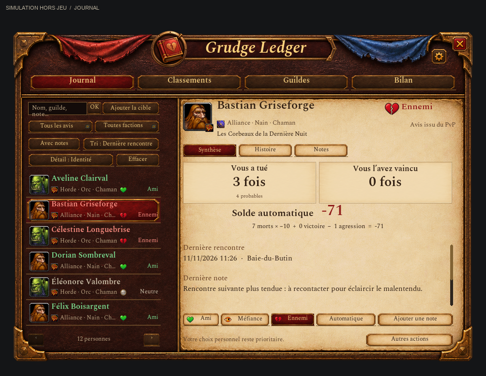
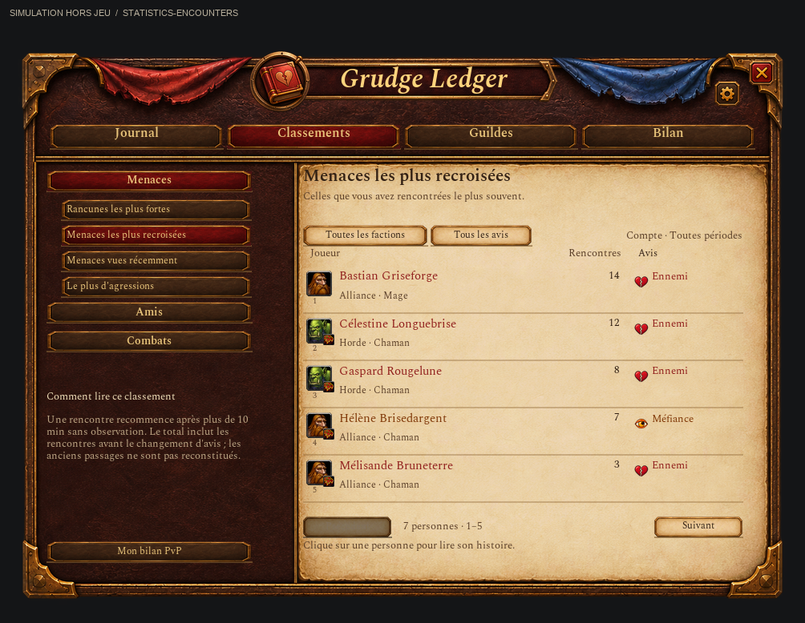
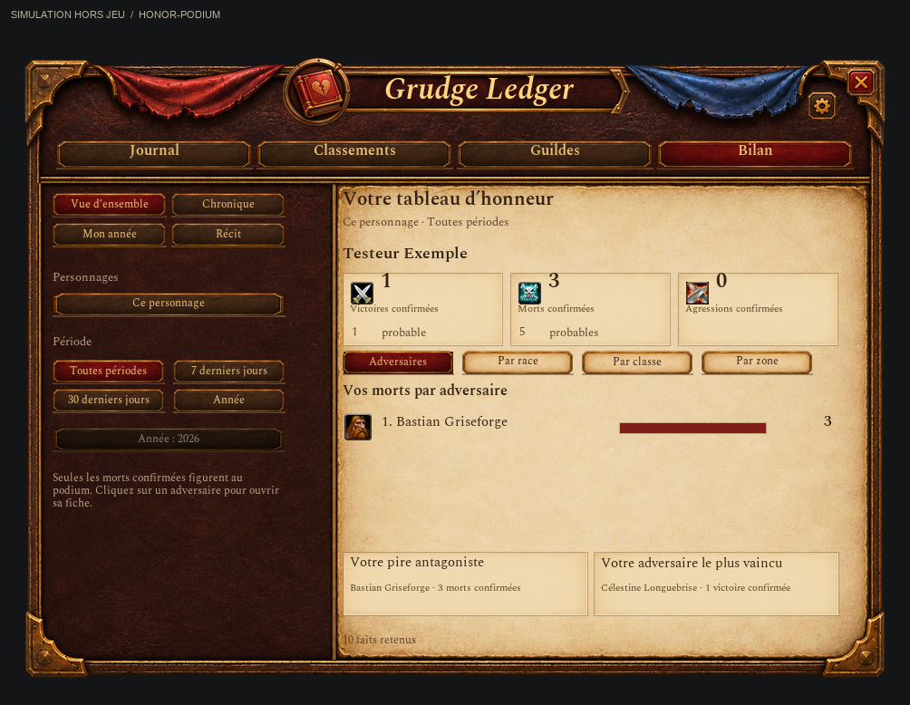

# Grudge Ledger — Le journal des rancunes


**Se souvenir des bonnes rencontres… et garder une petite trace des autres.**

Un petit addon pour **World of Warcraft Forever**, qui rassemble amis, ennemis, notes personnelles, avis sur les guildes et souvenirs de PvP.

[English](README.md) · [Télécharger](https://github.com/Aizakira/GrudgeLedger/releases/latest) · [Signaler un problème ou proposer une idée](https://github.com/Aizakira/GrudgeLedger/issues)

## Pourquoi cet addon ?

Il a été créé assez vite pour répondre à un besoin tout simple en jouant : reconnaître les personnes avec qui on a passé un bon moment, celles qui nous ont agressés, et se rappeler pourquoi un nom nous dit quelque chose.

Il a été **réalisé avec l'aide de ChatGPT, via Codex**, puis corrigé et vérifié au fil des essais et des tests automatisés. Les illustrations du livre rouge et les icônes de relation ont également été générées avec les outils d'image d'OpenAI.

C'est un petit projet personnel, partagé tel quel. Il pourra évoluer avec les retours, les envies et les contributions, sans calendrier promis. Prenez-le, testez-le, modifiez-le, faites votre propre version : il est là pour être utile et partagé, dans le cadre de sa licence GPLv3.

## Ce qu'il propose

- **Un menu au clic droit** sur les portraits et noms du chat pris en charge : Ami, Méfiance, Ennemi, avis positif ou négatif, note et fiche personnelle.
- **Des repères visuels** sur les barres de noms visibles : cœur vert pour les amis, œil orange pour la méfiance, cœur brisé rouge pour les ennemis. La coloration supplémentaire des noms est facultative.
- **Des filtres de faction et des identités détaillées** : combiner Amis, Méfiance ou Ennemis avec Alliance ou Horde, avec le nombre de personnes correspondantes. Race et classe apparaissent sous chaque nom et dans la fiche, avec leurs icônes natives lorsqu’elles sont disponibles. Les factions inconnues ont leur filtre ; les anciennes fiches se complètent à la prochaine rencontre observée. La race ne détermine jamais la faction.
- **Un historique PvP** des agressions et des morts observées, avec distinction entre faits confirmés et déductions probables. Une attribution erronée peut être corrigée.
- **La camaraderie par les emotes** que vous envoyez à un joueur ciblé, y compris de l'autre faction. Les répétitions sont limitées pour éviter de gonfler les scores.
- **Des avis sur des guildes entières**, avec des exceptions individuelles.
- **Une mémoire des guildes** : dernière guilde observée dans la fiche, puis copie de son nom, serveur et date d'observation dans chaque nouvel événement PvP. Une réponse vide n'efface plus la guilde connue ; un changement ultérieur ne réécrit pas les anciennes rencontres. Les guildes inconnues restent inconnues. Les classements utilisent ces événements en séparant les morts confirmées et probables.
- **Des alertes de rencontre** en bas à gauche, au-dessus du chat principal, avec un petit son, des délais entre répétitions et un regroupement pour les membres d'une même guilde. Elles suivent la position du chat en laissant une marge au-dessus des onglets. Aucun rappel pour les amis du groupe ou du raid. Les autres amis sont annoncés à la première rencontre, puis seulement après plus de dix minutes sans présence observée : chaque recroisement repousse ce délai, même après un rechargement d'interface. Chaque personnage possède son propre compteur.
- **Une liste centrée sur vos relations** : rejoindre un groupe n’ajoute plus les inconnus. Les groupes partagés sont suivis pour vos contacts ; les anciennes fiches constituées uniquement de groupes sont masquées sans effacement. Les avis, notes et événements PvP restent visibles.
- **Un journal personnel** pour les notes, rencontres, groupes partagés et événements PvP, accessible par le livre de la minimap ou `/gl`.



Le registre de campagne réunit le Journal, les Classements, les Guildes et le Bilan. Dans le Journal, filtrez les rencontres par avis et faction, puis ouvrez une fiche pour consulter le solde automatique, la dernière rencontre, l’histoire et les notes. Les portraits de race et les icônes de classe utilisent l’identité connue du jeu.

Le cuir, les drapés et le parchemin forment le décor. Le médaillon, le cartouche, la roue dentée et la croix sont des éléments indépendants. Le jeu dessine les textes et gère les clics. Le lettrage doré, les titres et le texte du grimoire utilisent les polices Spectral fournies avec l’addon. L’aperçu hors jeu utilise des personnages fictifs.

La roue dentée ou `/gl settings` ouvre les réglages. Dans **Apparence**, vous pouvez agrandir le texte, choisir la police de lecture et compacter l’espacement. Le guide de première ouverture est accessible depuis **Données et aide**.

La version 0.7.2 affiche le portrait actuel d’un contact lorsque Forever permet de le voir. À distance, sa fiche reprend un emblème de race, de classe ou de faction. Le Bilan regroupe aussi les combats par zone. Les attaques d’un familier sont rattachées à son maître si le jeu fournit leur lien.

Depuis la version 0.7.1, l’onglet Histoire permet de consulter chaque événement
et de vérifier son attribution avant de l’annuler. L’onglet Notes permet
d’écrire, de modifier et de parcourir les notes sur la fiche du joueur.
Dans Bilan, **Mon année** ouvre la chronique de l’année choisie. La fiche de guilde
présente sa règle et les exceptions individuelles. Pour vérifier la version
effectivement chargée par Forever, tapez `/gl version`.

## Solde de rancune

Les fiches automatiques comptent **−10 par mort, −1 par agression et +1 par victoire**. Les gestes négatifs s'ajoutent : une mort, un geste négatif et deux victoires donnent **−9**, donc **Méfiance (orange)** avec une alerte de proximité. Les victoires seules ne créent jamais d'amitié ; les gestes amicaux ne masquent pas une dette PvP encore négative. Les classements Ami/Méfiance/Ennemi et les avis manuels restent prioritaires. Les anciennes fiches automatiques sont recalculées sans effacer notes, compteurs ni historique.

Le bouton personnel **« Neutre » devient « Automatique »** : il restaure le calcul à partir des rencontres PvP et des gestes, au lieu d'imposer zéro. Les anciennes fiches bloquées par ce bouton sont réparées au chargement ; une dette de −9 reste orange. Un véritable zéro atteint avec les avis manuels +1/−1 reste un choix personnel. Notes, compteurs et historique sont conservés. Les règles de guilde restent distinctes.

Un **médaillon gris** identifie les personnes connues neutres dans le journal et sur leurs barres de noms. Elles ne déclenchent ni popup ni son. Les inconnus ne reçoivent pas de marqueur.


## 0.6.1 : des classements plus parlants

**Classements** ou `/gl stats` ouvre un livre organisé par thèmes :

| Thème | Ce qu'on peut retrouver |
| --- | --- |
| Menaces | Rancunes les plus fortes, menaces les plus recroisées, menaces vues récemment, agressions confirmées |
| Amis | Amis les plus recroisés, affinités les plus fortes, amis vus récemment, sessions de groupe partagées |
| Combats | Ceux qui m'ont le plus tué, adversaires les plus vaincus, morts et victoires probables séparées |
| Guildes | Rancunes personnelles, amis personnels, morts, victoires, agressions et morts probables |

Chaque classement affiche son unité, son périmètre et une explication. Les pages
Personnes/Guildes et le thème actif sont identifiés ; les listes de personnes
se filtrent par Alliance, Horde ou faction inconnue. Cliquer une personne ouvre
sa fiche ; sélectionner une guilde permet de définir un avis global.

**« Recroisées » décrit les rencontres enregistrées, pas une présence actuelle.**
Une nouvelle rencontre commence après plus de dix minutes sans observation.
Les relations sont celles d'aujourd'hui, mais les compteurs peuvent inclure des
rencontres ou groupes antérieurs à l'avis. Les dates récentes viennent uniquement
d'observations réelles : une note ou un changement d'avis ne rajeunit pas la date.
Un partenaire de groupe sans amitié ne figure pas parmi les amis.

Les guildes à zéro sont masquées pour le critère choisi. Les classements d'amis
et de rancunes décrivent les relations et dernières guildes connues actuelles ;
les combats gardent la guilde mémorisée au moment des faits. Les vues réutilisent
les compteurs existants, sans nouvelle surveillance en arrière-plan ni migration.



Validation : **26 scripts de tests et 48 vues hors jeu**, dont petites fenêtres,
listes vides, noms longs et police classique. Le rendu natif reste à confirmer.

## 0.6.0 : tableau d'honneur et chronique personnelle

Le bouton **Bilan & récit**, `/gl bilan` et `/gl chronique` ouvrent deux nouvelles
pages. Le bilan présente les victoires, morts et agressions observées, la némésis
et l'adversaire le plus vaincu. La chronique rassemble les événements de toutes
les fiches, avec date, lieu, personne et explication. Les faits confirmés restent
séparés des déductions probables.

- **Périodes et origine** : toutes les dates, sept ou trente derniers jours, année
  civile ; personnage actuel, compte entier ou archives sans personnage identifié.
  Les anciennes données ne sont pas attribuées artificiellement au personnage
  actuel. Une carte annuelle décrit seulement les événements enregistrés, sans
  export d'image pour l'instant. Le classement des amis recroisés reste explicitement
  une mémoire du compte sur toute la durée, faute de dates pour chaque rencontre.
- **Comptage** : une mort avec plusieurs adversaires ne compte qu'une fois dans le
  bilan lorsque son identifiant commun existe. Les archives sans cet identifiant
  ne permettent pas toujours ce regroupement. Les événements corrigés ou exclus
  comme champs de bataille ne gonflent pas les totaux.
- **Recherche et présentation** : plusieurs mots combinés dans les noms, guildes,
  notes, zones, races et classes ; filtres de relation, faction et présence de
  notes ; tri et seconde ligne configurables. La recherche dans la chronique
  attend Entrée ou OK pour éviter un recalcul à chaque lettre.
- **Notes personnelles** : navigation, modification et suppression avec confirmation,
  en préservant les brouillons lors des changements de police.
- **Avertissement de groupe facultatif** : désactivé par défaut dans les réglages.
  Il concerne un ancien agresseur avec des événements PvP, observé à proximité,
  en petit groupe uniquement. Ni ami, ni coéquipier, ni simple classement manuel
  sans événement PvP. Aucune note privée n'est envoyée. Limites : une annonce par
  minute, trente minutes par personne et plus de dix minutes sans présence observée
  avant un nouvel avertissement. Pas de messages différés ni d'annonce en champ
  de bataille, arène ou raid.

La règle **une mort = dix victoires** est conservée et testée : deux morts demandent
vingt victoires, sans effacer les autres dettes ni les décisions personnelles.
Le partage de rancunes et les primes entre membres d'une guilde restent des idées
pour plus tard. Le radar druide demeure en pause. Aucun service externe ajouté.



La version est vérifiée par 26 scripts de tests et 48 vues hors jeu. Les mesures
et limites des grands journaux sont dans la [revue d'architecture](docs/architecture.md).
La validation du rendu, des sons et des alertes sur le vrai client reste nécessaire.

## 0.5.12 : alléger les observations et l'affichage

Les vérifications périodiques partagent les informations d'identité pendant
moins d'une demi-seconde, avec contrôle du GUID actuel et lecture fraîche pour
les actions. Les marqueurs stables évitent les réécritures de texture et de
position. Les statistiques de guilde sont réutilisées jusqu'à un changement
utile ; le calcul des gestes ne relit que les nouveaux événements de l'historique.
Les souvenirs et choix personnels sont conservés, sans dépendance ni minuterie
supplémentaire en arrière-plan.

La [revue d'architecture et le benchmark reproductible](docs/architecture.md)
détaillent les mesures, les règles des caches et les limites des gros journaux.
Les tests hors jeu ne démontrent pas un gain de FPS réel. Le travail sur le radar
druide est mis de côté ; son fonctionnement expérimental manuel reste inchangé.

## 0.5.11 : retirer les anciennes rancunes de champs de bataille

Au premier chargement, les événements PvP dont le lieu identifie exactement le
Bassin Arathi, le Goulet des Chanteguerres ou la Vallée d'Alterac (noms français ou
anglais) sont exclus des scores et statistiques. Les fiches constituées uniquement
de ces combats, sans note ni avis personnel, quittent le journal actif et restent
conservées dans `battlegroundArchive`, dans vos SavedVariables privées.
Les fiches mixtes gardent leur historique avec la mention « champ de bataille,
non comptabilisé ». Les notes, gestes et avis personnels, règles de guilde et
événements extérieurs restent conservés. Un lieu inconnu n'est jamais deviné.
Ce nettoyage s'exécute une seule fois ; il ne travaille pas en arrière-plan.

## 0.5.10 : pause automatique en champ de bataille et en arène

Les champs de bataille et les arènes ne créent plus de rancunes automatiques et
ne modifient plus les scores, statistiques PvP, rencontres, souvenirs de groupe
ou avis liés aux émotes. Les alertes de proximité, marqueurs et ajouts aux
infobulles y sont également suspendus. Les déductions de combat en attente sont
abandonnées au changement de contexte pour éviter un enregistrement à la sortie.

Le journal, les notes et les classements manuels restent accessibles. Les fiches
existantes et les réglages sont conservés ; le suivi reprend automatiquement
à la sortie. Les donjons, raids et scénarios gardent leur fonctionnement habituel.

## 0.5.9 : valider le balayage et distinguer les vrais changements de zoom

Une notification de zoom ne suffit plus à interrompre l'essai. La mise à jour
suivante vérifie le zoom et la portée réels ; un changement indique les valeurs
mesurées. Si la portée initiale était illisible, la notification arrête toujours
l'essai avec une explication précise. Le rapport compte ces notifications.
Ce correctif traite un arrêt prématuré ; la détection fiable en jeu reste à valider.

Un essai réel en 0.5.7 sur le client 70888 a relu deux fois le joueur témoin sans
survol manuel, avec des contrôles vides réussis : 69 positions, 53 lectures et
12 textes distincts en 2,1 secondes. Cela valide ce témoin dans cet essai,
**pas douze joueurs identifiés ni une couverture continue fiable**.

Après `/reload`, en félin avec Pistage des humanoïdes actif, hors combat et
instance, cibler un joueur humanoïde immobile dont le point apparaît sur la minimap.
Ouvrir `/gl debug` → **Préparer la minimap** → **Validation druide**. La fenêtre
se ferme : placer la souris sur une zone vide du monde dans les trois secondes,
puis rester immobile. La minimap disparaît pendant au maximum 12 secondes.
`/glradar stop` annule. Le témoin n'a pas besoin d'être dans le livre.
Retrouver le résultat anonyme avec `/glradar rapport` ou Diagnostic.

`/glradar validation` tente les 225 positions de la grille, alors que `/glradar test`
s'arrête au premier témoin trouvé. Le rapport indique positions lues/ignorées,
durée, travail synchrone cumulé et appel le plus coûteux, si le chronomètre natif
est disponible. Ces mesures **excluent le rendu natif entre les appels** ; ce n'est
pas un bilan complet des FPS ou de la mémoire. La grille espacée peut manquer des points.

144 cas simulés vérifient protocole, interruptions/restauration, défaillances du
chronomètre et limites : au plus 229 lectures natives, une par image rendue,
12 secondes et dix rapports sans noms. Aucun balayage ne tourne au repos.
Avant un mode automatique facultatif, il faut vérifier en jeu les identités,
différents agencements de minimap, les interruptions et les ressources sur plusieurs
machines. Voir les [critères de validation](DEVELOPMENT.txt).
**Le radar reste manuel et expérimental.**

## Correctif 0.5.7 : les boutons de minimap interrompaient le balayage

Déplacer la minimap déplace aussi ses éléments attachés sous la souris immobile.
Le test confondait leur survol avec celui d'une fenêtre extérieure et s'arrêtait.
Il ignore désormais ces points pendant le balayage et indique leur nombre, sans
lire leur infobulle ni désactiver leurs boutons. Une fenêtre extérieure arrête
toujours l'essai ; un point de contrôle masqué empêche de valider le résultat.

113 cas simulés couvrent notamment cet arrêt au deuxième point, les éléments
imbriqués, les points masqués et la restauration. Un essai réel ultérieur a validé
un témoin ; la validation plus large est décrite ci-dessus. Le radar reste manuel.
`/reload` charge le correctif ; la procédure est
`/gl debug` → **Préparer la minimap** → **Validation druide**, avec un joueur témoin ciblé.

## Correctif 0.5.6 : comprendre les arrêts du test druide

Le rapport distingue désormais une cible absente, un PNJ/familier, soi-même et
une identité de joueur illisible ou incomplète. Pour la minimap, il indique la
propriété en cause et les valeurs reçue/attendue au lieu d'un message regroupant
sept contrôles. Les dimensions acceptent le même écart d'arrondi de 0,1 unité
d'interface que la position ; les changements réels arrêtent toujours le test.
La version de l'addon figure aussi dans le rapport, en plus du build du jeu.

**Le joueur témoin n'a pas besoin d'être dans le journal.** Une lecture réussie
peut avoir zéro correspondance connue. Cela n'explique pas un arrêt avant la
lecture du moindre point. Le test n'ajoute jamais le témoin au livre.

Un `/reload` charge cette mise à jour. La procédure ci-dessous reste identique ;
les tests automatisés vérifient le protocole, pas la disponibilité réelle des noms.

## Correctif 0.5.5 : préparation de l'essai druide dans le diagnostic

Le test appelait `Minimap:GetMaskTexture()`, absent des API Forever. La simulation
fournissait cette fonction à tort. L'addon observe désormais les appels natifs à
`SetMaskTexture` et restitue le masque exact, sans deviner un masque par défaut.
Si aucun masque n'a été observé depuis le chargement, le test s'arrête sans modification.
Après `/reload`, ouvrir `/gl debug` et cliquer sur **Préparer la minimap**. Ce bouton
réapplique explicitement l'apparence native de Forever avec la rotation actuelle ;
il ne change aucun réglage sauvegardé et préserve un habillage personnalisé déjà observé.
Une fois la minimap prête, cibler un joueur immobile visible sur la minimap, puis cliquer
sur **Validation druide** : la fenêtre se ferme et laisse trois secondes pour placer la souris
sur une zone vide du monde. Rester immobile, en félin, avec le pistage des humanoïdes actif.
La préparation ne lance aucun scan et est refusée en combat ou pendant un autre test.
Cela corrige la préparation ; **la lecture des joueurs reste à démontrer en jeu**.

## Nouveautés 0.5.3 : gestes et historique lisible

Les boutons **Bisou / Crachat** utilisent la cible sélectionnée comme les commandes
natives sans argument. Ils ne transmettent plus le nom littéral « target » et
n'ajoutent pas d'avis lorsque leur appel est refusé. Aucune faction n'est exclue.
**Cela ne restaure pas le texte ciblé de `/spit`, retiré par Blizzard** : si Forever
conserve cette restriction, le crachat reste au sol. Aucun faux message ou texte
personnalisé n'est substitué. [Notes officielles de la 9.1.5](https://worldofwarcraft.blizzard.com/en-us/news/23731242/915-content-update-notes).

Le journal précise qui a tué qui et distingue les participations possibles.
Les événements sont espacés, avec date, lieu, avis et raisons personnelles.
Les preuves techniques restent dans **Corriger le PvP**. Les nouveaux événements
conservent la sous-zone et la quête explicitement suivie lorsqu'elles sont disponibles,
sans deviner l'activité réelle ni réécrire les anciens souvenirs.
Les gestes restent des intentions enregistrées, sans confirmation de réception.

20 suites Lua 5.1 et 27 vues simulées vérifient la logique et l'agencement ; la
réception des émotes entre factions doit encore être vérifiée sur le client réel.
Depuis 0.5.2, un `/reload` suffit pour cette mise à jour.

## Nouveauté 0.5.1 : une icône de bisou reconnaissable

Le bouton Bisou affiche désormais des lèvres rouges peintes soufflant un petit cœur
rose, une illustration originale générée avec l'outil d'images d'OpenAI et intégrée
au cadre natif de WoW. Redémarrer le jeu après la mise à jour pour charger cette
nouvelle texture. Le fonctionnement des gestes reste identique.

## Nouveautés 0.5.0 : chroniques, guildes et diagnostic

- **Statistiques** dans le livre (`/gl stats`) : bourreaux, victoires, antagonistes par solde négatif, amis par score, amis et menaces recroisés. Morts/victoires probables ont leurs propres classements. Un clic ouvre la fiche.
- **Guildes** (`/gl guildes`) : nombre de rancunes personnelles et d'amis parmi les membres connus, morts confirmées/probables et agressions confirmées. Cliquer une guilde permet de la marquer **à surveiller**, amie, ou d'ouvrir ses avis et notes. Les choix personnels restent prioritaires. Les avis hérités d'une guilde ne créent pas artificiellement de rancunes personnelles dans le classement. Les faits sans guilde connue restent non attribués ; une ancienne guilde enregistrée au moment des faits conserve ces événements.
- **Bisou / crachat** : deux boutons avec les cadres natifs de WoW, au-dessus du chat, sous les alertes. Clic sur un joueur ciblé : `/kiss` (+1) ou `/spit` (−1), avec le même délai de 30 secondes par sentiment que les macros. Un geste positif n'efface pas une dette PvP. **Ctrl + glisser** déplace les deux boutons ; position mémorisée et bouton de remise en place dans les réglages. Aucun geste n'est envoyé automatiquement. Désactivables dans les réglages.
- **Rencontres distinctes** : compteur démarré à cette version, pour les joueurs déjà suivis ou couverts par un avis de guilde. Une nouvelle rencontre demande plus de dix minutes sans observation ; chaque présence renouvelle le délai. Le rechargement ne compte pas deux fois. Horloges séparées par personnage, statistiques réunies dans ce livre de compte. Ce n'est ni une mesure de distance ni du temps passé ensemble, et aucun ancien passage n'est inventé.
- **Diagnostic local** (`/gl traces`) : les 200 dernières décisions de détection/alerte, avec la raison (identité absente, délai, ami du groupe, alerte désactivée, affichée, etc.). Répétitions limitées à une fois par 30 secondes ; effaçable et désactivable. Les noms de ce journal local sont privés. **`/gl debug` produit la version anonymisée** pour un signalement. Les données sont dans `WTF/SavedVariables`, jamais dans le code distribué. WoW écrit la sauvegarde lors d'un `/reload` ou d'une déconnexion normale.
- **Test minimap intégré** (`/glprobe test`, `/glprobe stop`) : contrôle expérimental sur un point immobile avec référence au survol, relecture sans survol et contrôle vide anti-cache. Le résultat sans noms est sauvegardé avec le build du client et visible dans Diagnostic. Ce test manuel n'est pas la fonctionnalité finale : **aucun radar automatique ni changement automatique de pistage n'est activé**. Un résultat négatif sur un point resté immobile invalide cette méthode dans cet essai. Un résultat positif isolé ne suffit pas à valider un radar en mouvement.

La précédente extension temporaire `GrudgeLedgerProbe` doit être retirée ou désactivée : le test est désormais inclus dans Grudge Ledger. Redémarrer le jeu après l'installation de cette version pour charger les nouveaux fichiers.

Une mort ayant le même identifiant compte une seule fois par guilde, même avec plusieurs attaquants ; une preuve confirmée prime sur les participations probables. Plusieurs guildes peuvent participer à la même mort : leurs totaux ne s'additionnent pas. Sans identifiant commun, aucun regroupement des anciens événements n'est deviné.

Les tests Lua vérifient la logique simulée, y compris une API fonctionnelle, vide, protégée, indisponible ou un cache trompeur. Ils ne prouvent pas que le client réel donne accès aux points de la minimap : les essais dans Forever restent nécessaires. Une absence de trace ne prouve pas l'absence du joueur dans le monde.

## Installation et premiers pas

1. Télécharger le paquet de l'addon **`GrudgeLedger-<version>.zip`** dans les [versions publiées](https://github.com/Aizakira/GrudgeLedger/releases/latest).
2. Extraire le dossier `GrudgeLedger` dans `Interface/AddOns` du client Forever. Le fichier doit se trouver ici : `Interface/AddOns/GrudgeLedger/GrudgeLedger.toc`.
3. Redémarrer WoW et activer Grudge Ledger dans la liste des addons.

Aucune dépendance n'est nécessaire. Désactivez Grudgebook et Worth Remembering si vous les utilisez pour le même rôle, afin d'éviter les doublons de menus, marqueurs et alertes. Les archives automatiques **Source code** de GitHub contiennent aussi les fichiers de développement : seul leur dossier intérieur `GrudgeLedger` va dans `AddOns`.

Un clic gauche sur le livre ouvre le journal, un clic droit ouvre les réglages. Vous pouvez le faire glisser autour de la minimap. Pour ajouter quelqu'un, faites un clic droit sur son portrait ou son nom dans le chat, puis survolez **Grudge Ledger**. Pas besoin de recherche ni de commande. L'interface en jeu est actuellement principalement en français.

Pour voir les icônes et couleurs, cliquez sur **« Activer le repérage (icônes + couleurs) »** dans les réglages, ou utilisez `/gl reperage` hors combat. Cela active les barres des joueurs alliés, les barres ennemies et leur affichage hors combat, ainsi que les marqueurs et couleurs de l'addon. Les simples noms flottants ne sont pas des barres de noms modifiables. Un ami du groupe conserve son cœur ; seul le popup de proximité est supprimé. Si l'infobulle indique Ami mais que le cœur manque, activer le repérage hors combat. Le mode natif « nom uniquement » est pris en charge, y compris lorsque Threat Plates masque son propre texte. **Ennemi** donne le rouge ; **Méfiance** ou un simple avis négatif donne l'orange.

Quelques commandes facultatives, également utilisables dans une macro :

```text
/gl
/gl ami
/gl mefiance
/gl ennemi
/gl auto
/gl + Merci pour le donjon !
/gl - Mauvaise rencontre
/gl note
/gl guilde mefiance
/gl settings
/gl reperage
/gl debug
```

Les actions concernent le joueur ciblé. Le [guide complet](GrudgeLedger/README.txt) détaille les classements, les corrections et les sauvegardes.

## 0.5.2 : essai du détecteur druide sans survol manuel

Le test de curseur virtuel a échoué sur le client observé 70888. Une autre méthode
est maintenant testable : une minimap temporairement invisible est déplacée sous
la souris immobile, puis les infobulles natives sont lues. La souris ne bouge pas.

Après redémarrage du jeu, en extérieur et hors combat, passer en félin avec
**Pistage des humanoïdes** actif. Cibler un joueur humanoïde immobile dont le point
est visible sur la minimap. Placer la souris sur le décor, hors fenêtres, puis
taper `/glradar test` et rester immobile jusqu'au résultat, au maximum 12 secondes.
La minimap est temporairement masquée. `/glradar stop`, un déplacement ou le combat
interrompent le test. `/glradar rapport` donne le résultat sans noms, l'étape et
les compteurs ; il figure aussi dans Diagnostic. Désactiver tout autre scanner
de minimap pour isoler l'essai.

Le test exige deux lectures du nom témoin avec des contrôles vides avant, entre
et après. La grille bornée de 225 positions peut manquer un point ; un faible
nombre d'images par seconde peut limiter l'essai. **Le radar continu, les alertes
lointaines et le pistage automatique en félin ne sont pas activés.** Les 135 cas
automatisés vérifient le protocole et la restauration ; l'essai réel réussi décrit
plus haut ne valide pas encore toutes les situations. Aucune autorisation spécifique de Blizzard n'a été
obtenue. Voir [l'enquête et ses sources primaires](DEVELOPMENT.txt) et les
[instructions détaillées](GrudgeLedger/README.txt).

## Compatibilité et limites

Prévu pour **Forever, interface 16001** ; développé avec le client **1.60.1.70862**. Les versions Retail, Classic et les autres serveurs ne sont pas validés. Les marqueurs nécessitent des barres de noms visibles et respectent les limites de portée du jeu. Ce n'est ni un radar couvrant toute la zone, ni un détecteur de furtivité.

Forever peut masquer le journal de combat. L'addon consulte aussi son récapitulatif natif de mort, avec jusqu'à deux secondes d'attente. Il enregistre plusieurs agresseurs par GUID : le coup fatal explicite est confirmé, les autres participations à l'attaque mortelle sont probables. Sans preuve exploitable, seuls des adversaires en combat qui vous ciblaient récemment peuvent être retenus comme participants probables ; les simples passants sont exclus. Les compteurs sont individuels : trois participants à un même décès ne signifient pas trois morts du personnage. Les déductions peuvent être corrigées et la couverture reste limitée par les données fournies par le jeu. Les anciens décès manqués ne sont pas reconstitués automatiquement.

Les boutons Ami/Méfiance/Ennemi et les avis manuels conservent leur priorité, même après une emote. Les gestes seuls ne verrouillent plus le classement : un `/spit` ne bloque pas le passage en ennemi après une mort PvP. La détection des duels dépend des signaux disponibles.

Vingt scripts de tests automatisés, dont 77 scénarios de suivi et 135 cas du détecteur druide, accompagnent les sources. Ils simulent les API de WoW et ne remplacent pas les essais en jeu. C'est encore une jeune version : vos retours sont les bienvenus.

## Chacun son livre

Le journal est **vierge au départ** : aucun joueur, aucune guilde, aucune liste noire préremplie. Il est commun aux personnages d'un même compte et enregistré séparément par WoW dans `WTF/Account/<compte>/SavedVariables/GrudgeLedger.lua`.

Partager le dossier de l'addon ou son ZIP ne partage pas vos notes. Il n'y a ni échange automatique de listes entre joueurs ni télémétrie. Pour un signalement de bug, ne publiez pas votre dossier `WTF` ou vos SavedVariables. Le diagnostic facultatif `/gl debug` exclut les identités des joueurs, les noms des guildes, les notes et les erreurs brutes ; vous décidez de le copier et de le transmettre.

## Participer ou modifier

Les contributions sont bienvenues via un fork et une pull request. **@Aizakira
valide les changements avant intégration ; les versions officielles restent
publiées manuellement.** Le [guide de contribution](CONTRIBUTING.md) explique
les tests obligatoires et le fonctionnement de la revue.

Les issues et pull requests en français ou en anglais sont bienvenues. Pour un bug, précisez les versions de l'addon et du client, les étapes, le résultat attendu et le résultat observé. Masquez les informations personnelles des captures. Pour le code, privilégiez les changements ciblés et lancez les tests existants.

Python 3.11 est nécessaire uniquement pour les tests de développement :

```sh
python -m pip install --target test-runtime -r requirements-test.txt
python tests/run_tests.py
```

Les mêmes tests sont exécutés sur Linux et Windows par GitHub Actions. Voir [DEVELOPMENT.txt](DEVELOPMENT.txt) pour le rendu d'interface facultatif hors jeu. Depuis la racine du dépôt, cette commande crée une archive installable :

```sh
python -m zipfile -c GrudgeLedger-0.5.12.zip GrudgeLedger
```

## Licence et crédits

Le projet est sous **GNU GPL v3** : vous pouvez l'utiliser, l'étudier, le modifier, le partager et même le redistribuer commercialement, dans les conditions de cette licence. Les versions modifiées redistribuées doivent conserver les mentions, fournir leurs sources correspondantes et rester sous GPLv3. Le logiciel est fourni sans garantie. Voir [LICENSE](LICENSE).

Certaines techniques d'intégration des menus, barres de noms et infobulles sont adaptées de [Worth Remembering, par Kyle (maliceftw)](https://github.com/kk-on-gh/WorthRemembering), déjà sous GPLv3. Le suivi PvP a été réimplémenté en s'inspirant de l'approche décrite par [Grudgebook](https://www.curseforge.com/wow/addons/grudgebook). Aucun de ces addons n'est inclus ni requis. Les [crédits détaillés](GrudgeLedger/CREDITS.txt) sont conservés.

Les contributions originales, la documentation et les illustrations générées incluses sont partagées sous les mêmes conditions GPLv3. Les textures et sons natifs de WoW sont référencés depuis le client, sans être redistribués. Projet non officiel, sans affiliation avec Blizzard Entertainment ou OpenAI.
