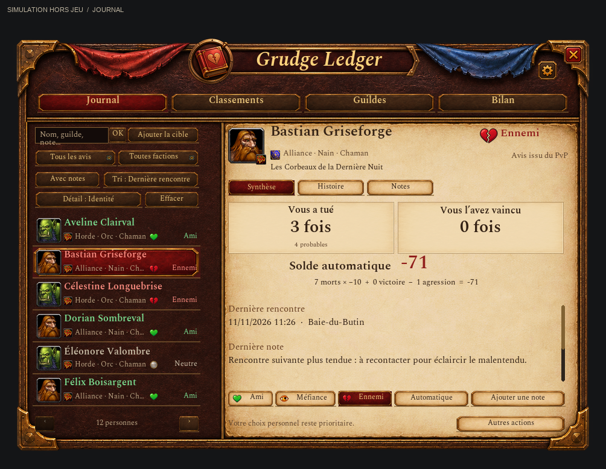

# Grudge Ledger


**Remember the good encounters. Keep a little book of grudges for the rest.**

A small personal player journal for **World of Warcraft Forever**: friends, enemies, notes, guild opinions and PvP encounters, brought together in one addon.

[Français](README.fr.md) · [Download](https://github.com/Aizakira/GrudgeLedger/releases/latest) · [Report a bug or suggest an idea](https://github.com/Aizakira/GrudgeLedger/issues)

## Why this exists

This was put together quickly to solve a simple problem while playing: remembering who was great to group with, who attacked us, and why a familiar name rang a bell. It was **created with the help of ChatGPT, through Codex**, with several rounds of fixes and automated checks. The red book and relationship icons were also generated with OpenAI's image tools.

It is a small hobby project, shared as it is, and it may evolve with playtesting, ideas and contributions. No grand roadmap or promised update schedule. If it is useful to you, take it, try it, fork it, improve it or adapt it to your own needs under the GPLv3 license.

## What it does

- **Right-click actions:** a compact “Grudge Ledger” submenu on supported player portraits and chat names. Mark a friend, caution or enemy, give a positive/negative opinion, add a note or open their record.
- **Visible reminders:** green hearts for friends, orange watchful eyes for caution and red broken hearts for enemies on visible player nameplates; optional name coloring and tooltip notes.
- **Faction filters and character details:** combine friends/caution/enemies with Alliance or Horde, with a count of the matching people. Race and class appear under each name and in the selected record, with native icons when available. Unknown factions have their own filter; older records fill in on the next observed encounter. Race never determines faction.
- **PvP memory:** records observed aggression and deaths. Inferred events are explicitly marked as probable and can be corrected without erasing your personal notes.
- **Friendly and unfriendly gestures:** your own targeted emotes can adjust camaraderie, including toward the opposing faction. Repeated emotes are rate-limited.
- **Guild opinions:** mark an entire guild, with individual exceptions.
- **Guild history:** keep the last observed guild and snapshot it separately for each new PvP event, including its realm and observation time. Missing replies do not erase known guilds; later membership changes never rewrite old encounters. Unknown guilds stay unknown. Guild rankings use these event snapshots and separate confirmed deaths from probable ones.
- **Nearby encounter alerts:** a small popup above the main chat in the lower-left area, with distinct sounds, cooldowns and grouped guild alerts. It follows the chat's position, leaving room above its tabs. Friends in your party or raid never trigger these alerts. Other friends alert on first sighting, then only after more than ten minutes without an observed presence; every sighting renews this window, including across UI reloads. Encounter clocks are separate for each of your characters.
- **No automatic roster clutter:** joining a group does not add unknown players. Group history is kept for existing contacts; legacy entries containing only group sessions are hidden without deleting them. Opinions, notes and PvP records remain visible.
- **A personal journal:** notes, encounters, shared groups and PvP history, accessed through the red book on the minimap or `/gl`.



The journal is an open, aged book with two parchment pages, stitched red leather, layered page edges and restrained brass corners. The index keeps a relationship icon, explicit label and dark readable ink. Classification and note-taking stay at the top; less frequent actions sit at the foot of the page. Its visual direction was inspired by Overlord, using original artwork. This preview is rendered from the actual Lua layout outside WoW, with synthetic records and approximated native fonts/icons.

The book follows its transparent artwork outline, without a rectangular black shadow. Shared buttons use gold lettering on leather and brown ink on parchment, with subtle underlines and separate hover, pressed, disabled and selected states.

Titles, names and journal text use WoW’s native calligraphic font families (Morpheus for the Latin alphabet). Notes use a 15-pixel reading/editing font; compact controls and small labels retain their regular font.

In **Settings** (`/gl settings`), enable **“Police classique (plus lisible)”** to use the native chat font at the same sizes instead of calligraphy. Disable it to restore the grimoire style. Titles, names and notes update immediately, drafts are preserved, and the choice is saved. Compact buttons keep their regular font.

## Grudge balance

Automatic records count **−10 per death, −1 per aggression and +1 per victory**. Negative gestures add to that balance: one death, one negative gesture and two victories leave **−9**, still **caution (orange)** with nearby alerts. Victories alone never create friendship; friendly gestures do not hide outstanding negative PvP debt. Explicit Friend/Caution/Enemy classifications and manual opinions stay authoritative. Existing automatic records are recalculated without deleting notes, counters or history.

The personal **“Neutre” button is now “Automatique”**: it restores scoring from PvP encounters and gestures instead of forcing zero. Legacy records pinned by that button are repaired on load; an outstanding −9 stays orange. A genuine zero reached through manual +1/−1 opinions remains a personal choice. Notes, counters and history are preserved. Guild rules remain separate.

A **gray medallion** marks known neutral people in the journal and on their visible nameplates. Neutral contacts do not trigger popups or sounds; unknown players remain unmarked.


## 0.5.8: validate a full scan and measure its cost

One live 0.5.7 trial on build 70888 read the selected witness twice without manual
minimap hovering, with successful blank controls: 69 positions, 53 reads and
12 distinct texts in 2.1 seconds. This validates that witness in that trial,
**not twelve identified players or reliable continuous coverage**.

After `/reload`, select a stationary humanoid player visible on the minimap,
in cat form with Track Humanoids active, outside combat and instances. Open
`/gl debug` → **Préparer la minimap** → **Validation druide**. The window closes;
place the pointer over empty world space within three seconds and stay still.
The minimap is temporarily hidden for at most 12 seconds. `/glradar stop` cancels.
The witness need not be in the journal. Retrieve the anonymous result with
`/glradar rapport` or Diagnostic.

`/glradar validation` attempts all 225 grid positions instead of stopping at the
first witness hit as `/glradar test` does. Reports show sampled/skipped positions,
duration, cumulative synchronous work and the longest measured call, when the
native timer is available. These timings **exclude native rendering between calls**;
they are not a complete FPS or memory benchmark. The coarse grid can miss dots.

135 simulated radar cases verify the protocol, interruption/restoration, optional
timer failures and limits: no more than 229 native reads, one per rendered frame,
12 seconds and ten name-free reports. No scanner runs while idle. Before enabling
an optional automatic mode, live tests must check identities, different minimap
layouts, interruptions and resource use on several machines. See the
[validation criteria](DEVELOPMENT.txt). **The radar remains manual and experimental.**

## 0.5.7: skip samples covered by minimap controls

Moving the minimap also moves attached controls underneath the stationary cursor.
The experiment previously treated their hover as an unrelated window and stopped.
It now skips and counts those scan samples without reading their tooltips or
disabling their controls. Unrelated UI still stops the experiment; an obstructed
blank control or witness replay cannot validate a result.

113 simulated cases cover the second-sample interruption, nested controls,
obstructed samples and restoration. A later live trial verified one witness;
the broader validation procedure is described above. The radar remains manual.
Use `/reload`, then `/gl debug` → **Préparer la minimap** → **Validation druide**, with
a stationary player selected as the witness.

## 0.5.6: distinguish druid test failures

The report now distinguishes a missing target, an NPC/pet, self-targeting and
an unreadable or incomplete player identity. Geometry failures identify the
property and its measured/expected values, instead of combining seven checks
into one generic error. Size checks allow the same 0.1 UI-unit rounding tolerance
as position checks; meaningful changes still stop the test. Reports include the
addon version as well as the client build.

**The witness does not need to be in the journal.** A successful reading can have
zero known matches. Missing knowledge does not explain a test that stops before
reading any points, and the test never adds the witness to the journal.

Use `/reload` for this update. The test procedure below is unchanged; automated
checks verify the protocol, not whether the native client supplies player names.

## 0.5.5: prepare the druid experiment from the diagnostic window

The experiment called `Minimap:GetMaskTexture()`, which Forever does not expose.
The test double incorrectly supplied that method. The addon now observes native
`SetMaskTexture` calls and restores their exact asset; it never guesses a default
mask. If no mask has been observed since load, the test stops before any mutation.
After `/reload`, open `/gl debug` and click **Préparer la minimap**. This explicitly
reapplies Forever's native minimap appearance using its current rotation setting;
it does not change saved settings or reset an already observed custom skin.
Once ready, select a stationary player visible on the minimap and click **Validation druide**:
the window closes, leaving three seconds to place the pointer on empty world space.
Stay still in cat form with Track Humanoids active. Preparation alone never starts
a scan, and remains unavailable during combat or another test.
This fixes preparation, **not proof that native player detection works**.

## 0.5.3: targeted gesture requests and readable history

Kiss/spit buttons now use the selected unit as the native commands do, instead of
passing the literal character name `target`. Rejected button calls no longer add
opinions through post-hooks. Both factions use native emotes without custom-text
substitutes. **This does not restore targeted `/spit` wording removed by Blizzard**;
if Forever retains that restriction, the recipient still sees a ground spit.
See the [official 9.1.5 notes](https://worldofwarcraft.blizzard.com/en-us/news/23731242/915-content-update-notes).

History clearly states who killed whom, separates suspected participation and spaces
events with dates, places and personal reasons. Raw PvP evidence remains available
in the correction window. New events snapshot the subzone and explicitly tracked
quest when readable, without guessing the current activity or enriching old events.
Gesture history records intent, not delivery confirmation. No saved history is deleted.

20 Lua 5.1 suites and 27 simulated UI views verify logic/layout, not actual recipient
messages across factions. A UI `/reload` is sufficient when upgrading from 0.5.2.

## 0.5.2: druid detection experiment without manual minimap hover

The virtual-cursor experiment failed on the observed Forever build 70888.
An alternative, explicitly started experiment now tests native tooltip reads
by briefly moving a hidden minimap under a stationary mouse. It never moves the
mouse, selects a target, changes tracking or creates grudges.

After restarting WoW, be outside combat and instances, in cat form with
**Track Humanoids** active. Target a stationary humanoid player whose dot is
visible on the minimap. Put the pointer over empty world space, type
`/glradar test`, and remain still for up to 12 seconds. The minimap temporarily
disappears. `/glradar stop` cancels; movement or combat also stops the test.
Use `/glradar rapport` or the diagnostic window to retrieve the name-free
outcome, failure stage and counters. Do not run another minimap scanner alongside it.

A positive result requires two matching full-name reads with blank controls
before, between and after. The bounded 225-point grid can miss a dot; low frame
rates can time out. **This does not yet enable a continuous radar, distant-threat
alerts or automatic tracking in cat form.** The 135 automated experiment cases
test our protocol and restoration logic; the single live success described above
does not establish reliability across players and configurations.
There is no specific Blizzard approval for this use. See the [investigation and
primary sources](DEVELOPMENT.txt) and [in-game test instructions](GrudgeLedger/README.txt).

## 0.5.1: a recognizable kiss icon

The kiss button now uses original painted red lips blowing a pink heart, generated
with OpenAI's image tool, inside the native WoW button frame. Restart the game after
updating to load the new texture. Gesture behavior is unchanged.

## 0.5.0: chronicles, guild rankings and diagnostics

A shared death ID counts once per guild, with confirmed evidence taking precedence over probable participation. Different guilds can be involved in the same death, so their totals are not additive. Legacy events without a shared ID are not guessed into one event.

The book now opens **Statistics** (`/gl stats`) and **Guild rankings** (`/gl guildes`). Rank player deaths, victories, negative balances, positive friendships and distinct encounters; probable PvP events stay in separate rankings. Guild lists count personal grudges/friends and historically attributed deaths/aggressions. Click a guild to mark it for caution, as friendly, or edit its rule/notes. Personal overrides still win, inherited rules do not inflate personal grudge counts, unknown historical guilds remain unassigned and membership changes never rewrite old events.

Two **kiss/spit** buttons with native WoW frames sit above chat, below alerts. Clicking acts on the selected player using the existing emote path (+1/−1, same 30-second sentiment cooldown). Ctrl-drag moves the pair; settings hide or reset it. No automatic emotes or forced targeting.

Distinct encounters begin with this version: another encounter requires over ten minutes without an observation, with every sighting renewing the clock. Reloads preserve continuity; character clocks are separate and totals belong to this account's book. No old visits or time-spent estimates are invented.

`/gl traces` displays a private, bounded 200-entry decision log explaining shown/suppressed alerts and missing readable identities. Repeats are throttled to 30 seconds. It can be cleared or disabled. `/gl debug` exports an anonymized report with no names/notes. SavedVariables stay separate from the shipped addon; normal logout or UI reload flushes them to disk.

The standalone minimap experiment is now integrated (`/glprobe test`, `/glprobe stop`): a stationary hovered reference, automatic re-read off the map, and a blank-point control distinguish real reads from stale caches. The name-free outcome and client build survive reloads. **This is a manual capability test, not an enabled automatic radar or tracking toggle.** A negative result is conditional on the tracked point staying still; even a positive isolated trial does not validate moving-world scanning. Unit tests cover working, blocked, missing, secret and stale-cache APIs; only live client observations establish what Forever actually allows. No trace does not prove a player was absent from the world.

Remove/disable the previous temporary `GrudgeLedgerProbe` addon to avoid command conflicts. Restart WoW once after updating to load the new source files.

## Install

1. Download **`GrudgeLedger-0.5.8.zip`** from [Releases](https://github.com/Aizakira/GrudgeLedger/releases/latest).
2. Extract the `GrudgeLedger` folder into your Forever client's `Interface/AddOns` folder. The final path must be `Interface/AddOns/GrudgeLedger/GrudgeLedger.toc`.
3. Restart WoW and enable Grudge Ledger in the addon list.

No other addon is required. Disable Grudgebook and Worth Remembering if they are installed for the same purpose, to avoid duplicate menus, markers and alerts. GitHub's automatic **Source code** archive contains developer files; only its inner `GrudgeLedger` folder belongs in `AddOns`.

Left-click the minimap book to open the journal, right-click it for settings, or drag it around the minimap. Right-click a player portrait or chat name to start adding people. Search and slash commands are optional. The in-game interface is currently primarily **French**.

For visible icons and colors, click **“Activer le repérage (icônes + couleurs)”** in settings, or run `/gl reperage` outside combat. This enables Forever's friendly-player nameplates, enemy nameplates and out-of-combat display, along with the addon's markers and name coloring. Plain floating world names are not editable nameplate labels. A friend in your party keeps their heart; only the nearby popup is suppressed. If the tooltip says Friend but the heart is missing, enable recognition outside combat. Native name-only nameplates are supported, including when Threat Plates hides its own name text. A player classified as **Ennemi** is red; **Méfiance** or a single negative opinion is orange.

| Command | Action |
| --- | --- |
| `/gl` | Open or close the journal |
| `/gl ami` / `/gl mefiance` / `/gl ennemi` | Mark your selected player as friend / caution / enemy |
| `/gl auto` (or `/gl neutre`) | Restore automatic scoring without erasing outstanding PvP debt |
| `/gl + Great dungeon!` | Add a positive opinion and note about the selected player |
| `/gl - Unpleasant encounter` | Add a negative opinion and note |
| `/gl note` | Open the note editor for your selected player |
| `/gl guilde mefiance` | Mark the selected player's guild as caution |
| `/gl settings` | Open settings |
| `/gl reperage` | Enable nameplates, markers and colors outside combat |
| `/gl debug` | Open a diagnostic report you can copy yourself |

See the [full usage guide](GrudgeLedger/README.txt) for neutral status, priorities, corrections and data backup.

## Compatibility and limits

Targets **Forever interface 16001**; development used client **1.60.1.70862**. Retail, Classic and other private-server clients are not validated. Nameplate markers require visible nameplates and obey the client's range and visibility rules. This is not a whole-zone radar or a stealth detector.

Forever may hide combat-log information. The addon also reads its public death recap, waiting up to two seconds for delayed data. Multiple attackers are recorded by GUID: an explicit lethal hit is confirmed, while other participants in the fatal attack remain probable. Without usable direct evidence, recent hostile PvP combatants actually targeting you may be recorded as probable participants; bystanders are excluded. Counters belong to each person's record: three participants in one death do not mean three player deaths. Inferences can be corrected and coverage is limited by the data the client exposes. Previously missed deaths are not reconstructed automatically.

Explicit Friend/Caution/Enemy buttons and manual opinions retain priority, including after an emote. Gestures alone no longer pin a relationship: `/spit` cannot keep a killer at caution when a PvP death is subsequently recorded. Duel detection still depends on the available client signals.

The existing offline suite covers fifteen test scripts, including 71 tracking scenarios. These tests simulate WoW APIs; they do not replace actual gameplay testing. This remains an early version, and bug reports are welcome.

## Your journal stays yours

Every new account starts with an **empty journal**. The addon contains no preset players, guilds or blacklists. Its account-wide database is saved by WoW in `WTF/Account/<account>/SavedVariables/GrudgeLedger.lua`, separately from the addon code. Sharing the addon folder or release ZIP does **not** share your notes. There is no automatic player-to-player database exchange or telemetry.

Never upload your `WTF` folder or SavedVariables when reporting an issue. The optional `/gl debug` report excludes player identities, guild names, notes and raw errors; you choose whether to copy and share it.

## Development and contributions

Contributions are welcome through forks and pull requests. **@Aizakira approves
changes before integration; official releases remain manual.** See the
[contribution and review policy](CONTRIBUTING.md) for the required checks and review process.

Python 3.11 and the pinned test dependency are only needed for development, not to play:

```sh
python -m pip install --target test-runtime -r requirements-test.txt
python tests/run_tests.py
```

GitHub Actions runs the same suite on Linux and Windows. See [DEVELOPMENT.txt](DEVELOPMENT.txt) for the optional offline UI renderer. To build an installable archive from the repository root:

```sh
python -m zipfile -c GrudgeLedger-0.5.8.zip GrudgeLedger
```

Issues and pull requests in French or English are welcome. For bugs, include the addon/client versions, steps to reproduce, expected and actual behavior, and a screenshot with personal information hidden if useful. Keep fixes focused and run the existing tests. Please do not submit anyone's personal journal.

## License and acknowledgments

**GNU GPL v3**, see [LICENSE](LICENSE). You may use, study, modify, fork and redistribute the project, including commercially, under that license. When distributing modified versions, preserve the notices, provide the corresponding source and keep them under GPLv3. This is not an unrestricted public-domain release; it is provided without warranty.

Menu integration and nameplate/tooltip lifecycle techniques are adapted from [Worth Remembering by Kyle (maliceftw)](https://github.com/kk-on-gh/WorthRemembering), under GPLv3. The independently implemented PvP module was informed by [Grudgebook](https://www.curseforge.com/wow/addons/grudgebook)'s described approach. Neither addon is bundled or required. See [full credits](GrudgeLedger/CREDITS.txt).

Original contributions, documentation and the included generated book and relationship artwork are shared under the same GPLv3 terms. Native WoW textures and sounds are referenced from the installed client, not redistributed. Unofficial project; not affiliated with Blizzard Entertainment or OpenAI.
